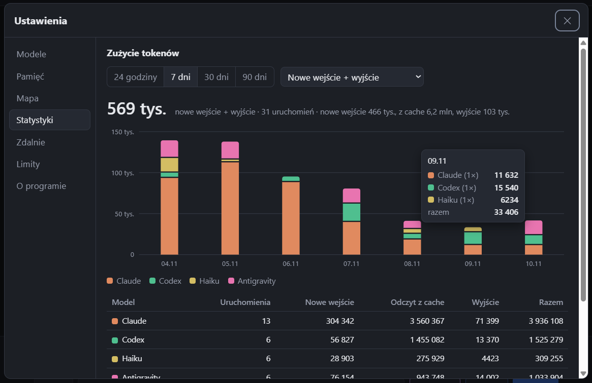
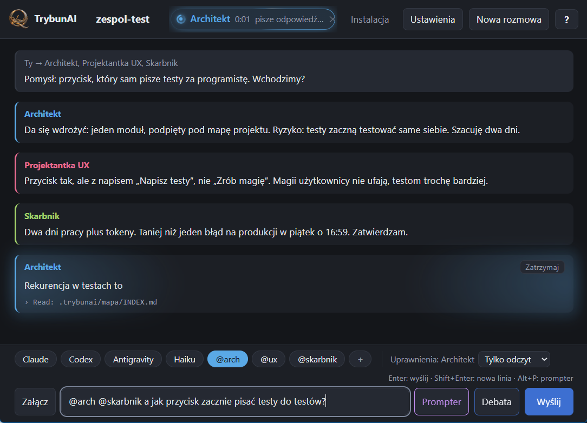
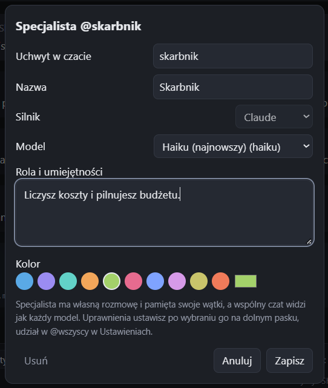
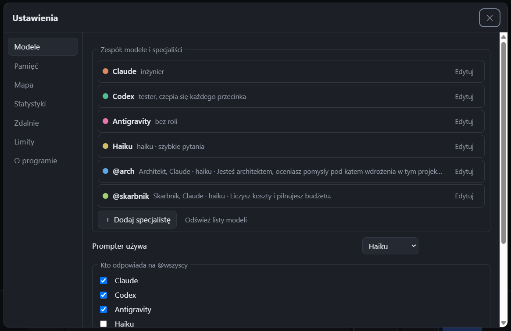
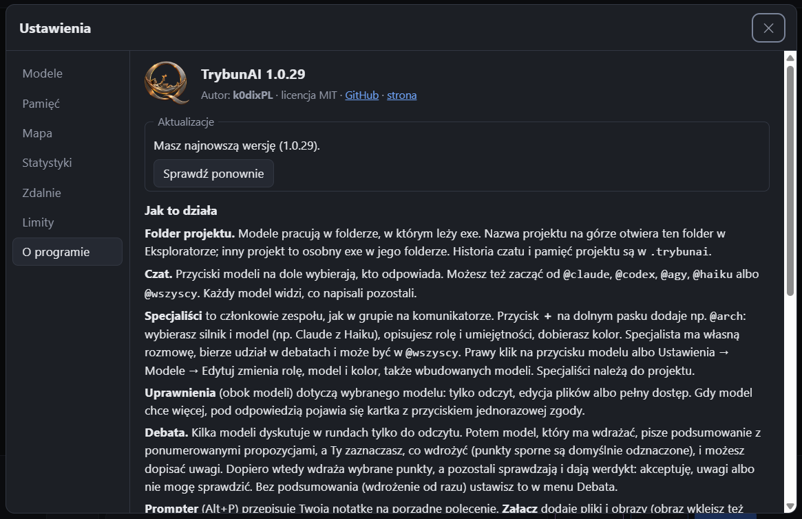
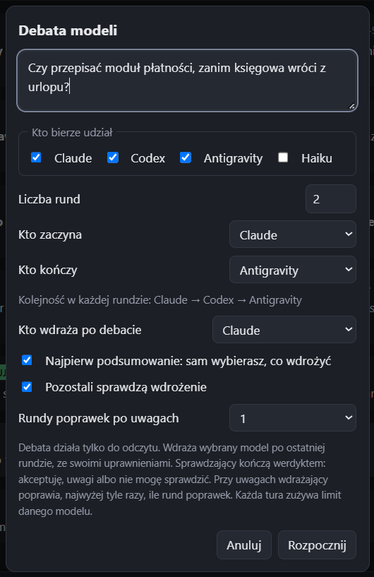
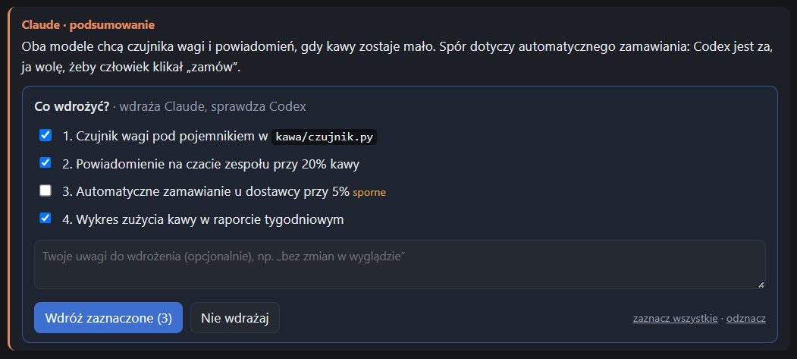

<p align="center"></p>

<h1 align="center">TrybunAI</h1>

<p align="center">Claude, Codex i Antigravity w jednym oknie czatu na Windows.<br>Jeden plik exe, zero konfiguracji w pliku tekstowym.</p>

<p align="center">
  <a href="https://github.com/k0dixPL/TrybunAI/releases/latest/download/TrybunAI.exe"><b>⬇ Pobierz TrybunAI.exe</b></a>
  &nbsp;·&nbsp;
  <a href="https://k0dixpl.github.io/TrybunAI/">Strona projektu</a>
  &nbsp;·&nbsp;
  <a href="https://github.com/k0dixPL/TrybunAI/releases">Wszystkie wersje</a>
</p>

<p align="center">
  <a href="https://github.com/k0dixPL/TrybunAI/releases/latest"></a>
  <a href="https://github.com/k0dixPL/TrybunAI/stargazers"></a>
  <a href="https://github.com/k0dixPL/TrybunAI/releases"></a>
  <a href="LICENSE"></a>
  
</p>

> ⭐ **Podoba Ci się TrybunAI?** Kliknij **Star** w prawym górnym rogu tej strony. Nic nie kosztuje, a pomaga innym znaleźć projekt.


*Debata w czacie: trzy modele proponują suchary, Claude wdraża, Codex daje werdykt „✓ AKCEPTUJĘ”. Na górze świeci pigułka Haiku, który właśnie pisze suchar o tokenach. Kończy się na limicie, jak zawsze.*

## Spis treści

- [Co to jest](#co-to-jest)
- [Jak zacząć](#jak-zacząć)
- [Funkcje](#funkcje)
- [Specjaliści](#specjaliści)
- [Ustawienia](#ustawienia)
- [Okno debaty](#okno-debaty)
- [Uprawnienia](#uprawnienia)
- [Skróty klawiszowe](#skróty-klawiszowe)
- [Uwagi, pytania, pomysły](#uwagi-pytania-pomysły)
- [Dla programistów](#dla-programistów)
- [Licencja](#licencja)

## Co to jest

TrybunAI to jeden plik `.exe`, który steruje narzędziami AI do programowania w folderze Twojego projektu:

| Narzędzie | Co to jest | Jak je wywołać |
|---|---|---|
| **Claude** | Claude Code | `@claude` |
| **Codex** | Codex CLI | `@codex` |
| **Antigravity** | Antigravity CLI (Google) | `@agy` |
| **Haiku** | Ten sam Claude Code, szybszy i tańszy model Haiku, własna rozmowa | `@haiku` |

Modele piszą we wspólnym czacie i widzą swoje odpowiedzi nawzajem. TrybunAI uruchamia je jako procesy w tle, czyta ich wyjście i pokazuje wszystko w jednym oknie.

## Jak zacząć

1. [Pobierz `TrybunAI.exe`](https://github.com/k0dixPL/TrybunAI/releases/latest/download/TrybunAI.exe) i skopiuj go do folderu projektu. Modele pracują w folderze, w którym leży exe.
2. Uruchom. Przycisk **Instalacja** doinstaluje brakujące narzędzia i po kolei otworzy okna logowania.
3. Pisz. Historia czatu i pamięć projektu zapisują się w folderze `.trybunai` obok exe.

Potrzebne są własne konta: Claude (np. plan Pro), ChatGPT dla Codexa i/lub konto Google dla Antigravity.

> Plik nie jest podpisany cyfrowo, więc Windows może pokazać ostrzeżenie SmartScreen. Kliknij **Więcej informacji → Uruchom mimo to**.

## Funkcje

- **Jeden projekt, jedno okno.** Modele pracują w folderze, w którym leży exe. Nazwa projektu na środku górnego paska otwiera ten folder w Eksploratorze. Inny projekt to osobna kopia exe w jego folderze.
- **Wspólny czat.** Przyciski pod polem wpisu wybierają, kto odpowiada. Możesz też zacząć od `@claude`, `@codex`, `@agy`, `@haiku` albo `@wszyscy`. `@wszyscy` odpowiada w kolejności ustawionej w Ustawieniach.
- **Widać, kto pracuje.** Pracujący model ma na górnym pasku świecącą pigułkę w swoim kolorze: czas pracy, bieżąca czynność (np. „Edit: ui/index.html”), kliknięcie przewija do odpowiedzi, a ✕ zatrzymuje model. Jego dymek pulsuje poświatą. Podczas aktualizacji pamięci pojawia się pigułka „Pamięć”.
- **Zaznaczanie i kopiowanie.** Tekst odpowiedzi zaznaczysz myszą i skopiujesz jak w przeglądarce.
- **Debaty.** Kilka modeli dyskutuje w rundach, tylko do odczytu. Potem wybrany model wdraża, a Ty zaznaczasz, co wdrożyć. Szczegóły: [Okno debaty](#okno-debaty).
- **Specjaliści, czyli zespół jak w grupie na komunikatorze.** Przycisk **＋** na dolnym pasku dodaje członka zespołu, np. `@arch`: silnik i model (np. Claude z Haiku), rola i umiejętności, kolor. Każdy ma własną rozmowę, bierze udział w debatach i może odpowiadać na `@wszyscy`. Szczegóły: [Specjaliści](#specjaliści).
- **Role modeli.** Wbudowane modele też mają rolę, model i kolor do ustawienia: prawy klik na przycisku modelu albo Ustawienia → Modele → Edytuj. Rola trafia do promptu tego modelu.
- **Zgody na żądanie.** Gdy model chce zrobić coś ponad swoje uprawnienia, pod odpowiedzią pojawia się kartka z tym, o co prosi. Możesz pozwolić jednorazowo.
- **Pamięć projektu.** Zwięzłe ustalenia zamiast całej historii. Nowa sesja modelu zaczyna od pamięci, co oszczędza limity. Szczegóły: [Pamięć](#pamięć).
- **Mapa projektu.** Krótkie notatki o kodzie: pliki, funkcje z numerami linii i dziennik zmian. Nowa sesja zaczyna od mapy, zamiast przeszukiwać cały program. Szczegóły: [Mapa](#mapa).
- **Załączniki PDF.** Tekst z PDF-a trafia do promptu każdego modelu. Dzięki temu modele czytają PDF-y także w trybie „Tylko czytaj”. Limit znaków ustawiasz w Ustawieniach → Modele.
- **Statystyki zużycia.** Wykres tokenów w czasie, z podziałem na modele, za 24 godziny, 7, 30 albo 90 dni.
- **Limity kont.** Plan i zużycie limitów każdego konta, odczytane bez zużywania limitu.
- **Prompter.** Zamienia szybką notatkę w porządny prompt.
- **Zdalne sterowanie Claude.** Pozwala prowadzić sesje Claude z aplikacji Claude na telefonie.
- **Aktualizacje.** Program sprawdza nowe wydania na GitHubie. Gdy jest nowsza wersja, przy przycisku „?” pojawia się kropka.

<p align="center"></p>

*Ustawienia → Statystyki. Claude czyta najwięcej, bo czyta cały projekt. Haiku czyta mało i jest tani. Statystyki nie oceniają, tylko liczą.*

## Specjaliści

Specjalista to kolejny członek zespołu z własnym `@uchwytem`. Pod spodem działa jedno z zainstalowanych narzędzi (Claude Code, Codex albo Antigravity) z wybranym modelem i rolą, którą sam opisujesz. Dzięki temu do dyskusji o projekcie dochodzi architekt, projektant UX, tester czy skarbnik, każdy w swoim kolorze.

- **Dodawanie:** przycisk **＋** na dolnym pasku albo Ustawienia → Modele → „＋ Dodaj specjalistę”. Podajesz uchwyt (2–16 znaków: małe litery, cyfry, `-`, `_`), nazwę, silnik, model, rolę i kolor.
- **Rozmowa:** `@arch` na początku wiadomości pyta architekta, `@arch @ux` obu naraz. Specjalista ma własną sesję, więc pamięta swoje wątki, a wspólny czat widzi jak każdy model.
- **Edycja:** prawy klik na przycisku specjalisty albo Ustawienia → Modele → Edytuj. Silnika istniejącego specjalisty nie da się zmienić, bo jego rozmowa należy do konkretnego narzędzia.
- **Uprawnienia** ustawiasz jak przy każdym modelu: wybierz go na dolnym pasku. Domyślnie „Tylko odczyt”.
- **`@wszyscy` i debaty:** specjalistę zaznaczasz w Ustawieniach → Modele → „Kto odpowiada na @wszyscy”. W oknie debaty jest na liście uczestników i może wdrażać.
- **Usunięcie** chowa specjalistę z paska. Jego wiadomości zostają w historii z nazwą i kolorem.
- Specjaliści należą do projektu i zapisują się w `.trybunai/chat.json`.

<p align="center"></p>

*Architekt liczy dni, Projektantka UX pilnuje napisów, Skarbnik zatwierdza. Na górze świeci pigułka Architekta, który właśnie tłumaczy rekurencję w testach.*

<p align="center"></p>

*Skarbnik działa na Haiku. Liczy koszty, więc sam też wybrał tani model.*

## Ustawienia

Ustawienia otwierasz przyciskiem **Ustawienia** na górnym pasku. Zakładki są po lewej. Zmiany zapisują się same po zamknięciu okna (✕ albo Esc).

| Zakładka | Co tam jest |
|---|---|
| **Modele** | Zespół: modele i specjaliści z rolą, modelem i kolorem, silnik Promptera, kto odpowiada na `@wszyscy`, limit tekstu z PDF-a |
| **Pamięć** | Edycja pamięci projektu, przycisk „Zapisz stan teraz”, automatyczna świeża sesja |
| **Mapa** | Włącznik mapy, pomijane katalogi, odświeżenie, dziennik zmian, pliki startowe |
| **Statystyki** | Wykres i tabela zużycia tokenów |
| **Zdalnie** | Włącz i wyłącz zdalne sterowanie Claude, link do przeglądarki |
| **Limity** | Plany i zużycie limitów kont, przycisk „Odśwież” |
| **O programie** | Wersja, autor, sprawdzanie aktualizacji, instalacja nowej wersji, linki do GitHuba i strony |

<p align="center"></p>

*Codex ma rolę „tester, czepia się każdego przecinka”. Nie odpowie na pytanie o kawę. Ma pisać testy.*

### Modele

| Opcja | Co robi |
|---|---|
| Prompter używa | Wybiera narzędzie, które przepisuje notatkę na prompt (Alt+P) i aktualizuje pamięć projektu |
| Kto odpowiada na `@wszyscy` | Zaznaczasz modele i ustalasz ich kolejność |
| Zespół | Wbudowane modele i specjaliści. „Edytuj” zmienia model (lista z zainstalowanych CLI albo wpisany; „domyślny” wybiera samo CLI), rolę (do 1000 znaków, dopisywana do promptu) i kolor. Haiku zawsze używa modelu Haiku. „＋ Dodaj specjalistę” dodaje członka zespołu, „Odśwież listy modeli” wczytuje listy od nowa |
| Tekst z załączonego PDF-a, najwyżej znaków | Ile znaków tekstu z PDF-a trafia do modelu. Domyślnie 30 000, zakres 0–500 000. Wartość 0 wyłącza dołączanie tekstu PDF-ów |

### Pamięć

| Opcja | Co robi |
|---|---|
| Pole pamięci | Treść pamięci projektu. Możesz ją edytować ręcznie |
| Zapisz stan teraz | Przerzuca to, co ustalono w czacie, do pamięci projektu |
| Świeża sesja automatycznie, gdy kontekst przekroczy 150 tys. tokenów | Model dostaje świeżą sesję z pamięcią, zamiast ciągnąć długą historię |

Pamięć aktualizuje się przy nowej rozmowie, przy świeżej sesji i po kliknięciu „Zapisz stan teraz”.

### Mapa

| Opcja | Co robi |
|---|---|
| Prowadź mapę projektu i dziennik zmian | Włącza budowę mapy w `.trybunai/mapa` i zapisywanie zmian modeli |
| Pomijaj katalogi | Katalogi z danymi (oddzielone przecinkami), które nie trafią do mapy ani dziennika. Zawsze pomijane są `.git`, `.venv`, `node_modules`, `dist`, `build` i foldery zaczynające się od kropki |
| Odśwież teraz / Otwórz folder mapy | Przebudowuje mapę albo otwiera jej folder w Eksploratorze |
| Ostatnie zmiany modeli | Dziennik zmian, który pozostałe modele czytają przy swojej następnej turze |
| Pliki startowe | Tworzy brakujące `CLAUDE.md`, `AGENTS.md` i `GEMINI.md`, które odsyłają do `REGULY.md` i mapy. Istniejących plików nie rusza |

Mapa zawiera `INDEX.md` z listą plików i notatkę dla każdego modułu Pythona: publiczne funkcje i klasy z numerami linii oraz zależności między modułami.

### Statystyki

| Opcja | Co robi |
|---|---|
| 24 godziny / 7 dni / 30 dni / 90 dni | Okres na wykresie |
| Nowe wejście + wyjście | Liczy tokeny, które model czyta pierwszy raz, i to, co napisał |
| Wszystko, także odczyt z cache | Dodaje powtórnie czytany początek sesji. Tych tokenów jest dużo, ale są tańsze |
| Tylko wyjście | Liczy tylko to, co model napisał |

Dane są w `.trybunai/tokeny.jsonl` i nie znikają po „Nowej rozmowie”. Wcześniejsza historia jest dołączana z dzienników Claude i Codexa.

### Zdalnie

| Opcja | Co robi |
|---|---|
| Włącz / Wyłącz | Uruchamia albo zatrzymuje `claude remote-control` na tym komputerze |
| Otwórz w przeglądarce | Otwiera sesję w przeglądarce (dostępne po uruchomieniu) |

Sesje widać w aplikacji Claude (zakładka Code) i na claude.ai/code, na tym samym koncie. Działa, dopóki TrybunAI jest otwarty i komputer nie śpi. Zdalnie działa tylko z Claude. Codex i Antigravity nie są dostępne zdalnie.

### Limity

Pokazuje plan każdego konta i zużycie okien limitów. Przycisk **Odśwież** czyta dane od nowa.

### O programie

<p align="center"></p>

*Aktualizacja jest jak poniedziałek: zawsze przychodzi, ale zawsze można ją odłożyć.*

Pokazuje wersję i autora. Przycisk **Sprawdź ponownie** szuka nowszego wydania. Gdy jest nowsza wersja, przycisk **Zaktualizuj** pobiera ją i uruchamia program od nowa. Linki prowadzą do GitHuba i strony projektu.

## Okno debaty

Przycisk **Debata** otwiera okno z tymi opcjami:

| Opcja | Co robi | Domyślnie |
|---|---|---|
| Temat | Pytanie albo zadanie dla modeli | pusty |
| Kto bierze udział | Zaznaczasz modele | — |
| Liczba rund | Od 1 do 10 rund dyskusji | 2 |
| Kto zaczyna / Kto kończy | Kolejność w każdej rundzie | — |
| Kto wdraża po debacie | Model, który wprowadza ustalenia w kodzie | — |
| Najpierw podsumowanie | Model pisze listę propozycji, a Ty zaznaczasz, co wdrożyć | włączone |
| Pozostali sprawdzą wdrożenie | Po wdrożeniu inni modele dają werdykt | wyłączone |
| Rundy poprawek po uwagach | 0 (tylko werdykt), 1 albo 2 | 1 |

<p align="center"></p>

*Debata: dwie rundy, zero kawy, jeden wykonawca.*

### Podsumowanie i wybór

Gdy debata ma wdrażającego, nic nie zmienia się w plikach od razu. Wdrażający pisze podsumowanie: na czym stanęło, gdzie zostały różnice zdań, i ponumerowaną listę propozycji. Pod nim pojawia się karta:

- zaznaczasz, co wdrożyć (punkty oznaczone jako sporne są domyślnie odznaczone),
- możesz dopisać własne uwagi, które mają pierwszeństwo przed ustaleniami debaty,
- **Wdróż zaznaczone** uruchamia wdrożenie i sprawdzanie tylko wybranych punktów, **Nie wdrażaj** kończy sprawę.

Modele czekają, ile trzeba. Wybór przetrwa zamknięcie programu. Wyłączenie opcji „Najpierw podsumowanie” przywraca wdrożenie od razu po debacie.

<p align="center"></p>

*Automatyczne zamawianie kawy jest sporne, więc domyślnie odpada. Księgowa odetchnęła.*

Werdykty: **✓ AKCEPTUJĘ**, **! UWAGI** albo **? NIE MÓGŁ SPRAWDZIĆ**. Debata działa tylko do odczytu. Wdraża dopiero wybrany model, z jego uprawnieniami.

## Uprawnienia

Każdy model ma własny tryb, wybierany obok przycisków modeli pod czatem:

| Tryb | Co model może |
|---|---|
| Tylko odczyt | Czytać pliki i szukać. Zmian nie wykona |
| Edycja plików | Czytać i zmieniać pliki w folderze projektu |
| Pełny dostęp | Wykonywać dowolne polecenia na tym komputerze bez pytania i bez piaskownicy |

Zmiana na „Pełny dostęp” pyta o potwierdzenie. Gdy model poprosi o więcej, niż ma, zgodę dajesz tylko na jedną operację.

## Skróty klawiszowe

| Skrót | Działanie |
|---|---|
| Enter | Wyślij wiadomość |
| Shift + Enter | Nowa linia |
| Alt + P | Prompter: przepisz notatkę na prompt |
| Ctrl + V | Wklej obraz ze schowka jako załącznik |
| Ctrl + C | Kopiuj zaznaczony tekst z czatu |

## Uwagi, pytania, pomysły

- 💬 [Dyskusje](https://github.com/k0dixPL/TrybunAI/discussions): pytania, pomysły i wrażenia z używania.
- 🐞 [Zgłoś błąd](https://github.com/k0dixPL/TrybunAI/issues/new): opisz, co się stało i co zrobiłeś wcześniej. Podaj wersję z przycisku „?”.

## Dla programistów

```powershell
.venv\Scripts\python.exe -m unittest discover -s tests   # testy
.\build.ps1                                              # testy + budowanie dist\TrybunAI.exe
```

Mapa kodu jest w `.trybunai/mapa/INDEX.md`. Najważniejsze moduły:

| Moduł | Rola |
|---|---|
| `trybun/core.py` | Sesja czatu: historia, wspólny kontekst, uruchamianie CLI, Prompter |
| `trybun/agents.py` | Wiedza o każdym CLI: jak je wywołać i jak czytać ich wyjście |
| `trybun/mapa.py` | Budowa mapy projektu i dziennika zmian |
| `trybun/stats.py` | Zużycie tokenów w czasie |
| `trybun/limits.py` | Plany i limity kont |
| `trybun/models.py` | Listy modeli do Ustawień |
| `trybun/remote.py` | Zdalne sterowanie Claude |
| `trybun/setup.py` | Instalacja i logowanie CLI |
| `trybun/update.py` | Sprawdzanie i instalacja nowej wersji |
| `ui/index.html` | Cały interfejs okna |

Wydanie: podbij wersję w `trybun/__init__.py`, dopisz wpis w `CHANGELOG.md`, zrób commit i tag `vX.Y.Z`, a potem wypchnij. GitHub Actions zbuduje exe i opublikuje go w *Releases*. Zasady numeracji są w [`CLAUDE.md`](CLAUDE.md) i [`REGULY.md`](REGULY.md). Historia zmian: [`CHANGELOG.md`](CHANGELOG.md).

## Licencja

[MIT](LICENSE): możesz używać, zmieniać i rozpowszechniać, także komercyjnie, zachowując informację o autorstwie.
