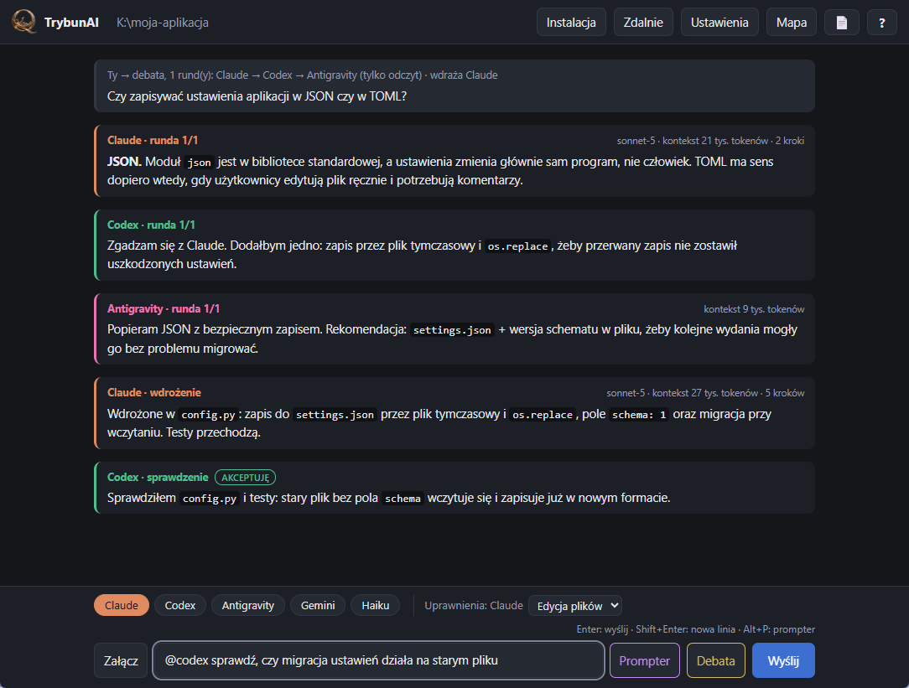

<p align="center"></p>

<h1 align="center">TrybunAI</h1>

<p align="center">Claude, Codex i Antigravity w jednym oknie czatu na Windows.</p>

<p align="center">
  <a href="https://github.com/k0dixPL/TrybunAI/releases/latest/download/TrybunAI.exe"><b>⬇ Pobierz TrybunAI.exe</b></a>
  &nbsp;·&nbsp;
  <a href="https://k0dixpl.github.io/TrybunAI/">Strona projektu</a>
  &nbsp;·&nbsp;
  <a href="https://github.com/k0dixPL/TrybunAI/releases">Wszystkie wersje</a>
</p>



## Co to jest

TrybunAI to jeden plik `.exe`, który steruje narzędziami AI do programowania (Claude Code, Codex, Antigravity CLI) w folderze Twojego projektu. Modele piszą we wspólnym czacie i widzą nawzajem swoje odpowiedzi.

- **Wspólny czat:** `@claude`, `@codex`, `@agy`, `@haiku`, `@wszyscy`.
- **Debaty:** przycisk *Debata* — uczestnicy, liczba rund, kto zaczyna i kończy, kto wdraża ustalenia, a reszta sprawdza z werdyktem (akceptuję / uwagi / nie mogę sprawdzić) i ograniczoną liczbą rund poprawek.
- **Role modeli:** np. Claude inżynier, Codex tester, Antigravity pedagog — ustawiane raz w Ustawieniach.
- **Zgody na żądanie:** gdy model chce zrobić coś ponad swoje uprawnienia, widzisz co dokładnie i możesz jednorazowo pozwolić.
- **Pamięć projektu:** zwięzłe ustalenia zamiast ogromnej historii; długie sesje odświeżają się same, co oszczędza limity.
- **Limity:** plan i zużycie limitów każdego konta w Ustawieniach, rozmiar kontekstu przy każdej odpowiedzi.
- **Uprawnienia na model:** tylko odczyt, edycja plików albo pełny dostęp. Debaty zawsze tylko do odczytu.
- **Prompter:** przepisuje szybką notatkę na porządny prompt.

## Jak zacząć

1. [Pobierz `TrybunAI.exe`](https://github.com/k0dixPL/TrybunAI/releases/latest/download/TrybunAI.exe) i skopiuj go do folderu projektu. Modele pracują w folderze, w którym leży exe.
2. Uruchom. Przycisk **Instalacja** doinstaluje brakujące narzędzia i po kolei otworzy okna logowania.
3. Pisz. Historia i pamięć projektu zapisują się w `.trybunai` obok exe.

Potrzebne są własne konta: Claude (np. plan Pro), ChatGPT dla Codexa i/lub konto Google dla Antigravity.

> Plik nie jest podpisany cyfrowo, więc Windows może pokazać ostrzeżenie SmartScreen: **Więcej informacji → Uruchom mimo to**.

## Dla programistów

```powershell
.\build.ps1          # testy + budowanie dist\TrybunAI.exe
.venv\Scripts\python.exe -m unittest discover -s tests
```

Licencja: [MIT](LICENSE) — możesz używać, zmieniać i rozpowszechniać, także komercyjnie, zachowując informację o autorstwie.

Wydanie: podbij wersję w `trybun/__init__.py`, dopisz wpis w `CHANGELOG.md`, a potem wypchnij tag, np. `git tag v1.0.9; git push origin v1.0.9`. GitHub Actions zbuduje exe i opublikuje je w *Releases*. Zasady numeracji: [`CLAUDE.md`](CLAUDE.md), historia zmian: [`CHANGELOG.md`](CHANGELOG.md).
